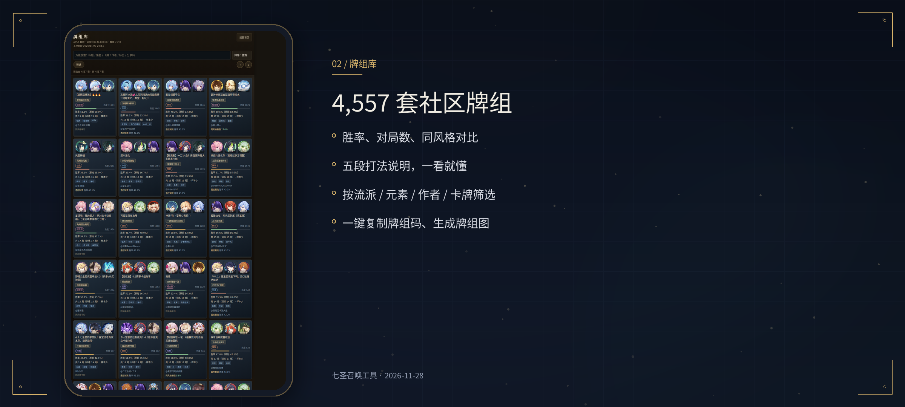
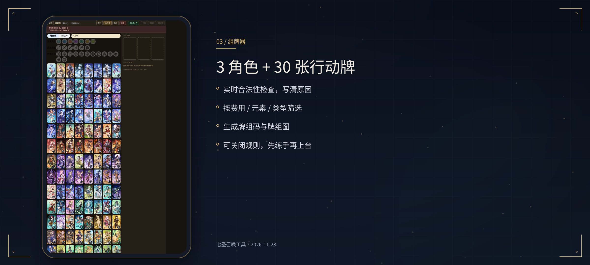
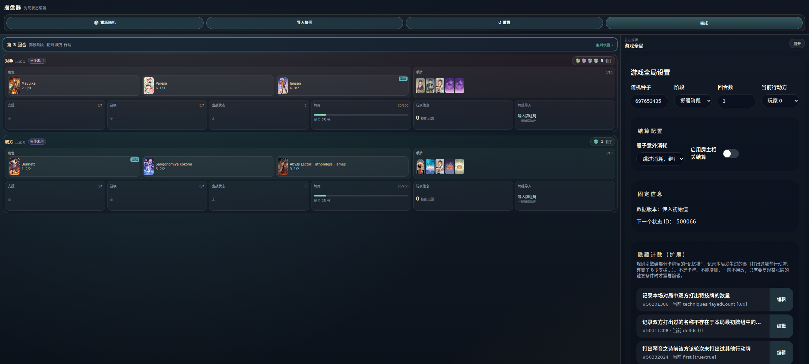
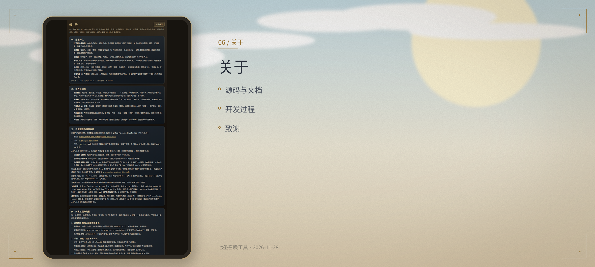
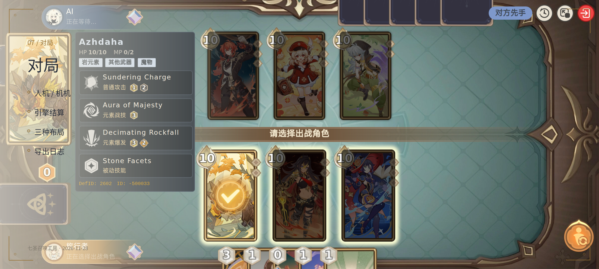

# 七圣召唤工具（离线版）

**对局模拟器 · 牌组库 · 卡组实验室 · 组牌器 · 摆盘器 · AI 训练器**

全部离线运行 · 零权限 · 不联网 · 安卓 10+

**快速导航**：
[用户指南](./docs/USER-GUIDE.zh.md) ·
[文档索引](./docs/README.md) ·
[AI 实现详解](./docs/AI-实现详解.zh.md) ·
[架构](./docs/ARCHITECTURE.zh.md) ·
[构建](./docs/BUILD.zh.md) ·
[安卓壳](./android/README.md) ·
[项目总总结](./artifacts/项目总总结-2026-11-28.md)

> 基于开源项目 [piovium/genius-invokation](https://github.com/piovium/genius-invokation) 二次开发，
> 遵循 **AGPL-3.0**，来源与美术版权声明见 [NOTICE.md](./NOTICE.md)。

> **项目状态（2026-11-28）**：工具功能已完成，**AI 研究线已封存**（不再迭代，仅保留搜索版 AI）。
> 总总结见 [artifacts/项目总总结-2026-11-28.md](./artifacts/项目总总结-2026-11-28.md)。

---

## 一、这是什么

把七圣召唤（Genshin TCG）的**离线打牌环境**做成一个能装进口袋的小工具：
想练牌随时开一局，想研究环境有 AI 帮你跑克制推演，想分享牌组一键出图。

和原版网页工具的区别：

| | 原版 gi-tcg | 本项目 |
|---|---|---|
| 运行方式 | 需要联网加载资源 | 资源全部内置，飞行模式可用 |
| 应用形态 | 浏览器网页 | 安卓 APK（WebView 壳，可离线装） |
| 权限 | — | **零权限**（连 INTERNET 都没有） |
| 界面 | 桌面网页布局 | 按手机 20:9 重做的手游布局 + 原神风皮肤 |
| AI | 网页端对弈 | 本地多线程搜索 + 可自我迭代的训练器 |

## 二、功能

### 1. 对局模拟器
- 完整规则引擎：事件、技能、元素反应、召唤物、状态、骰子，全部按规则结算；
- **人机对战**（和内置 AI 打）/ **机机观战**（AI 自对弈，适合看套路）；
- 对局日志逐帧回放，可导出复盘；
- 三种横屏布局：20:9 等比 / 20:9 拉伸 / 锚点偏移（16:9、16:10、3:2、19.5:9 自适应）。

### 2. 牌组库
- 社区牌组 4,557 套，带**胜率、对局数、同风格对比、五段打法说明**；
- 按流派、元素、来源、作者、卡牌筛选；
- 支持本地训练补齐样本、按对手牌组反查克制关系。

### 3. 卡组实验室
- 输入对手牌组码 → 多线程 AI 穷举候选牌组 → 找出克制它的那套；
- 每副候选的对局数可调（2/4/6/10/20/30，默认 6），线程数可调；
- 结果直接落库，一键生成牌组图/克制列表。

### 4. 组牌器
- 三个角色 + 30 张行动牌的正规组牌流程；
- 按费用、元素、卡牌类型筛选，实时合法性检查并写清不合规原因；
- 一键生成牌组码、牌组图，直接分享；
- 支持「合法性检查」开关（练手时可以关掉规则限制）。

### 5. 摆盘器
- 自由编辑局面：手牌、牌库、骰子、角色位置、召唤物状态；
- 摆好一键开局，或导出局面快照；
- 打完回到编辑器继续改，不用从头摆。

### 6. AI 训练器（电脑端）
- Node 写的多线程自我对弈训练器，和手机端同一套 AI；
- 每批打完把经验合并进 `learning.json`，牌组胜率、角色/卡牌偏好同步变准；
- 导出的 `gitcg-trained-ai-*.json` 可在工具里「设置 → 导入 AI 数据」回灌手机；
- 详见 [docs/TRAINER.zh.md](./docs/TRAINER.zh.md)。

## 三、界面预览

> 全部截图按 **2400×1080（20:9）** 重新渲染：竖屏页面配文字说明，对局页为完整横屏画面。

<table>
<tr>
<td width="50%"> 首页 · 六大入口，离线可用</td>
<td width="50%"> 牌组库 · 4,557 套社区牌组</td>
</tr>
<tr>
<td> 组牌器 · 3 角色 + 30 牌，实时合法性</td>
<td> 卡组实验室 · 穷举克制牌组</td>
</tr>
<tr>
<td> 摆盘器 · 自由编辑任意局面</td>
<td> 关于 · 开源、踩坑与致谢</td>
</tr>
</table>

 对局模拟器 · 角色出战选择（20:9 横屏）

## 四、整体结构

- 手机端 APK：`WebView` → `hub 首页` → 模拟器 / 牌组库 / 组牌器 / 摆盘器 / 关于；
- 模拟器依赖 `core 引擎` 与 `ai 搜索`；牌组库依赖 `deck-library.json`；
- AI 搜索读取 `经验库`；摆盘器复用 `core` 引擎；
- 电脑训练器通过「导入经验包」把结果写回 `经验库`。

## 五、目录结构

| 目录 | 作用 |
|---|---|
| `packages/` | pnpm monorepo |
| `core/` | 对局引擎（规则、状态机、reducer） |
| `ai/` | AI：搜索、进化、经验库、牌组池 |
| `data/` | 卡牌与角色数据 |
| `web-ui-core/` | 对局界面组件（棋盘、手牌、骰子、技能面板） |
| `deck-builder/` | 组牌器组件 |
| `state-editor/` | 摆盘器组件 |
| `standalone/` | 独立 Web 应用入口（hub / 模拟器 / 实验室 / 牌组库） |
| `android/` | 安卓 WebView 壳（MainActivity、资源拦截、设置页、build.sh） |
| `trainer/` | 电脑端 AI 训练器 |
| `promo/` | 宣传片工程（Motion Canvas） |
| `docs/` | 文档 |

## 六、快速开始

### 网页版（开发调试）

bash
# 安装依赖（copy 模式，避免硬链接失败）
pnpm install --config.package-import-method=copy
# 构建资源清单
pnpm --filter @gi-tcg/assets-manager build
# 构建对局界面组件
pnpm --filter @gi-tcg/web-ui-core build
# 构建组牌器组件
pnpm --filter @gi-tcg/deck-builder build
# 构建独立应用（产物在 packages/standalone/dist）
pnpm --filter @gi-tcg/standalone build

# 本地起服务看效果
cd packages/standalone/dist && python3 -m http.server 8899
# 首页    http://127.0.0.1:8899/hub.html
# 模拟器  http://127.0.0.1:8899/app.html

### 安卓 APK

bash
# 把 Web 产物复制到安卓壳工程（目录名必须是 dist-lab）
cp -r packages/standalone/dist /path/to/android/dist-lab
# 进入安卓目录并打包（需要 android-sdk、d8、apksigner）
cd android && ./build.sh

详细步骤、坑与版本号位置见 [docs/BUILD.zh.md](./docs/BUILD.zh.md)。

### 资源与数据

美术素材与社区牌组数据不入库（版权与体积原因），抓取方式见
[docs/ASSETS.zh.md](./docs/ASSETS.zh.md)。

## 七、文档

| 文档 | 内容 |
|---|---|
| [docs/ARCHITECTURE.zh.md](./docs/ARCHITECTURE.zh.md) | 各包职责、运行时数据流、安卓壳实现、AI 结构 |
| [docs/BUILD.zh.md](./docs/BUILD.zh.md) | **从零构建与打包**：环境版本、素材、构建顺序、APK、常见失败、牌组构筑规则 |
| [android/README.md](./android/README.md) | 安卓包从零构建：工具链、入口对调、签名与校验 |
| [docs/DEVLOG.zh.md](./docs/DEVLOG.zh.md) | 迭代记录：每个版本改了什么、问题根因 |
| [docs/PITFALLS.zh.md](./docs/PITFALLS.zh.md) | 踩坑清单：现象 / 根因 / 解法 |
| [docs/TRAINER.zh.md](./docs/TRAINER.zh.md) | 训练器设计、参数、经验导出与回灌 |
| [docs/ASSETS.zh.md](./docs/ASSETS.zh.md) | 卡面 / 数据 / 牌组库抓取说明 |
| [docs/DATA.zh.md](./docs/DATA.zh.md) | 牌组码编码、牌组库条目、AI 经验包、缓存键 |
| [docs/UI.zh.md](./docs/UI.zh.md) | 设计 token、比例规则、对局布局约束、排版层级 |
| [docs/TESTING.zh.md](./docs/TESTING.zh.md) | 截图 / DOM 尺寸 / 像素采样 / AI 自对弈验收法 |
| [docs/ROADMAP.zh.md](./docs/ROADMAP.zh.md) | 路线图 |
| [docs/USER-GUIDE.zh.md](./docs/USER-GUIDE.zh.md) | 带图新手指南：从首页到打一局 |
| [docs/INSTALL.zh.md](./docs/INSTALL.zh.md) | 安装、系统要求、卸载与重置 |
| [docs/GLOSSARY.zh.md](./docs/GLOSSARY.zh.md) | 术语表（对局 / 工具 / AI） |
| [docs/AI.zh.md](./docs/AI.zh.md) | **AI 原理、强度定位、强度旋钮、局限** |
| [docs/AI-实现详解.zh.md](./docs/AI-实现详解.zh.md) | **AI 全景实现详解**：代码走读、搜索/价值/策略/DMC、术语表、44 维特征 |
| [docs/AI-ROADMAP.zh.md](./docs/AI-ROADMAP.zh.md) | **14 个 AI 组件路线图、阶段门槛、成本** |
| [docs/KNOWN-ISSUES.zh.md](./docs/KNOWN-ISSUES.zh.md) | **已知问题与限制、规避方式** |
| [CHANGELOG.md](./CHANGELOG.md) | 版本更新日志 |
| [CONTRIBUTING.md](./CONTRIBUTING.md) | 贡献指南 |
| [SECURITY.md](./SECURITY.md) | 隐私与权限声明 |

## 八、FAQ

**Q：为什么不直接发完整源码包（含素材）？**
素材版权归米哈游，仓库只放代码与抓取脚本，自己构建时按文档拉取即可。

**Q：为什么 APK 连 INTERNET 权限都没有？**
安卓壳用 `WebViewClient.shouldInterceptRequest` 从 `assets/` 直接出内容，
不需要网络栈；origin 固定 `http://127.0.0.1:8765` 以便 localStorage 有稳定域。

**Q：AI 有多强？**
诚实定位：不比熟练玩家强，靠搜索预算和经验库堆出来的稳定度；
胜率数据来自自我对弈，不含人类对局。**AI 研究线已于 2026-11-28 封存**，
最终结论见 [AI 终结报告](./artifacts/ai/AI-终结报告-2026-11-28.md)。

**Q：AI 到底什么水平？**
比随便打强，不如熟练玩家；原理、强度旋钮和局限都写在
[docs/AI.zh.md](./docs/AI.zh.md)，已知问题见 [docs/KNOWN-ISSUES.zh.md](./docs/KNOWN-ISSUES.zh.md)。
实测数据、失败清单与复现方法见 [artifacts/ai/README.md](./artifacts/ai/README.md)。
现状：搜索版对启发式约 60%，对熟练玩家仍处下风；DMC 尝试（0.1ms/手）只到 150ms 搜索水平，
未达上线门槛，已封存。

**Q：能在电脑上用吗？**
可以，用网页版（`pnpm --filter @gi-tcg/standalone dev`）或构建后本地起服务。

## 九、致谢

- **项目起源：[雨酱牌]**——这个项目最初来自雨酱牌；
- **主要编程与代码工作：DeepSeek Harness**——开发、实验编排、训练与文档均由 DeepSeek Harness 完成；
- 规则引擎与卡牌数据：[piovium/genius-invokation](https://github.com/piovium/genius-invokation) 及其贡献者；
- 卡牌美术、图标、界面素材：miHoYo / HoYoverse；
- 社区牌组：牌组广场与米游社的各位作者。

## 十、许可

代码以 **AGPL-3.0** 分发，见 [LICENSE](./LICENSE)。
修改后再分发（包括以服务形式提供）时，请保留同样许可并公开源码。

---

## 相关文档

- [AI-EXPERIMENTS.zh.md](docs/AI-EXPERIMENTS.zh.md) · [AI-ROADMAP.zh.md](docs/AI-ROADMAP.zh.md) · [AI-实现详解.zh.md](docs/AI-实现详解.zh.md) · [AI.zh.md](docs/AI.zh.md)
- [AI实验交接-2026-11-27.md](docs/AI实验交接-2026-11-27.md) · [ARCHITECTURE.zh.md](docs/ARCHITECTURE.zh.md) · [ASSETS.zh.md](docs/ASSETS.zh.md) · [BUILD.zh.md](docs/BUILD.zh.md)
- [DATA.zh.md](docs/DATA.zh.md) · [DEVLOG.zh.md](docs/DEVLOG.zh.md) · [GLOSSARY.zh.md](docs/GLOSSARY.zh.md) · [INSTALL.zh.md](docs/INSTALL.zh.md)
- [KNOWN-ISSUES.zh.md](docs/KNOWN-ISSUES.zh.md) · [PITFALLS.zh.md](docs/PITFALLS.zh.md) · [README.md](docs/README.md) · [ROADMAP.zh.md](docs/ROADMAP.zh.md)
- [TESTING.zh.md](docs/TESTING.zh.md) · [TRAINER.zh.md](docs/TRAINER.zh.md) · [UI.zh.md](docs/UI.zh.md) · [USER-GUIDE.zh.md](docs/USER-GUIDE.zh.md)
