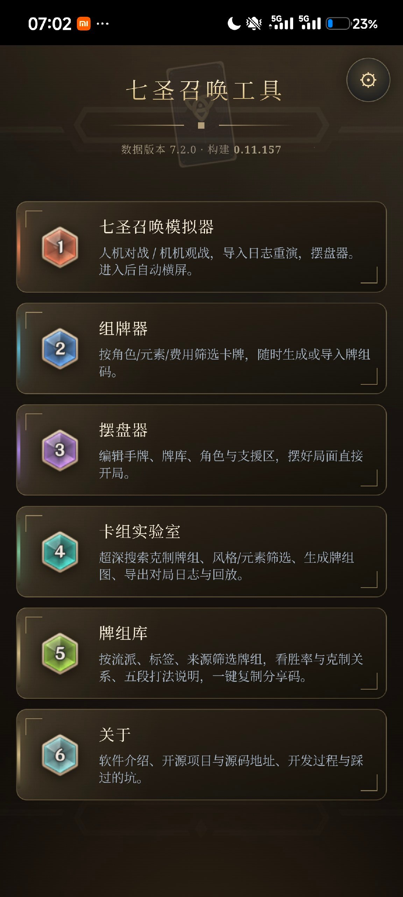
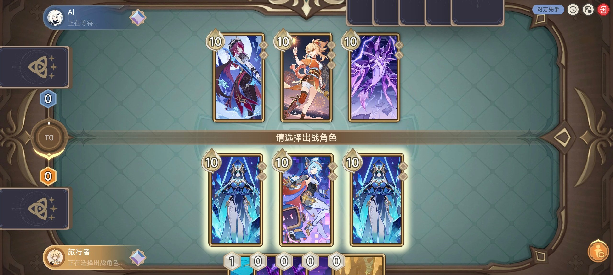
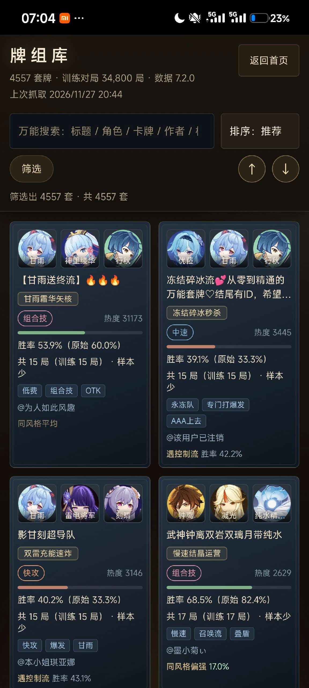
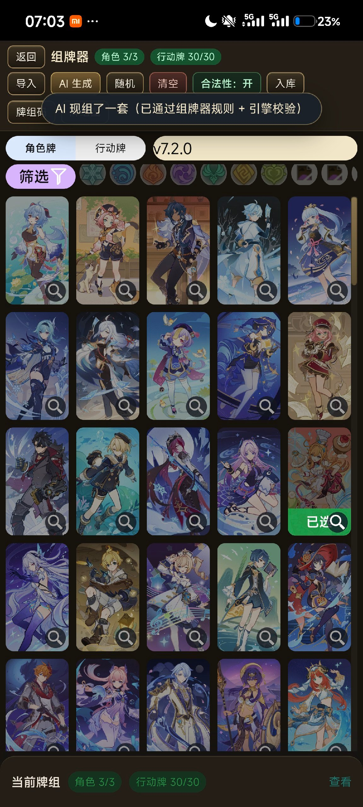
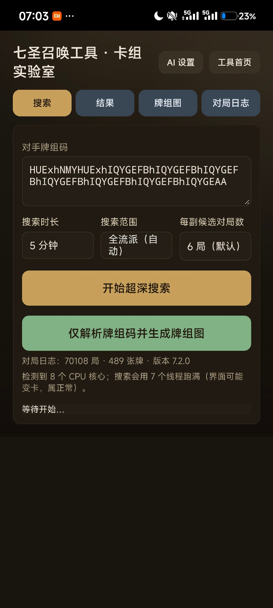
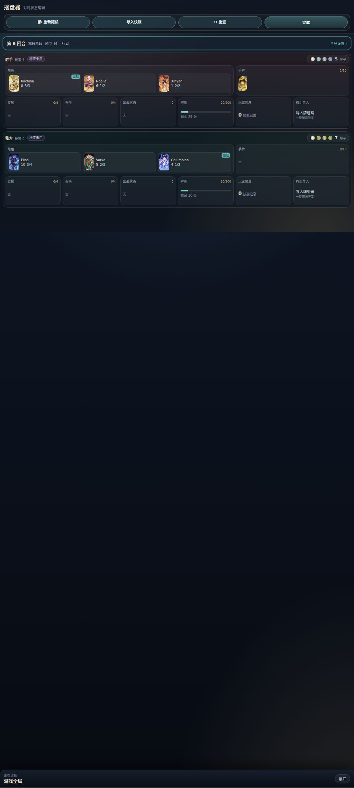

# 新手使用指南

按图的顺序走一遍，5 分钟上手。

---

## 1. 首页

六个入口，一屏点完。顶部是版本号，右上角齿轮进设置。

- **设置**：5 项——AI 数据备份、牌组库备份、对局界面布局、主体方向、牌组图高画质，逐项见第 9 节或 [SETTINGS.zh.md](./SETTINGS.zh.md)；
- 工具页可以竖屏看，进对局会自动转横屏。

## 2. 打一局

1. 首页点「七圣召唤模拟器」；
2. 顶部选对局模式：
   - **人机对战**：你和 AI 打；
   - **机机观战**：两个 AI 打，适合看套路；
3. 选好双方牌组（或点「随机」）；
4. 点「开始对局」。

- 中间是双方角色区，下面是手牌和骰子；
- 点角色/技能/手牌出行动，右上角是回合与阶段；
- 结束后可以「查看日志」逐帧回放。

## 3. 牌组库

- 顶部筛选：流派、元素、来源、作者、卡牌；
- 每张卡片显示：角色、胜率、对局数、打法标签；
- 点进去看详情：牌组码、五段打法、同风格对比；
- 收藏、复制牌组码、一键生成牌组图。

## 4. 组牌器

1. 先选 3 个角色（不能重复）；
2. 再挑 30 张行动牌（可按费用/元素/类型筛选）；
3. 右上角有合法性检查：不合规会写清原因；
4. 合规后可「生成牌组码」「导出牌组图」「加入牌组库」。

### 构筑规则（不合规时对照）

| 规则 | 说明 |
|---|---|
| 3 个角色 | 不能重复；先定角色再挑牌 |
| 30 张行动牌 | 少一张、多一张都不合规 |
| 同名最多 2 张 | 秘传 / 祝佑（`GCG_TAG_LEGEND`、`GCG_TAG_CARD_BLESSING`）**整副最多 1 张** |
| 天赋牌 | 要求队伍里有对应角色（`relatedCharacterId`） |
| 元素共鸣 | 要求队里至少有 2 个该标签角色（`relatedCharacterTag`） |
| 版本环境 | 卡牌数据会随版本更新；用新版本打开旧牌组码，可能出现"卡不存在 / 费用变化"，属版本差异 |

**拿到别人的牌组时**：牌组库搜索 → 详情 → 复制牌组码 → 组牌器导入 → 合法性检查；
有不理解的地方看提示里的具体条目，而不是笼统的"不合规"。

更完整的构建/打包/环境说明见 [BUILD.zh.md](./BUILD.zh.md)。

## 5. 卡组实验室

1. 粘贴对手的牌组码（或从牌组库选一套）；
2. 设置「每副候选对局数」（2~30，默认 6）；
3. 点「开始深度搜索」，等进度条跑完；
4. 结果按克制率排序，点进去看详情，可一键生成牌组图。

## 6. 摆盘器

1. 拖拽摆放双方手牌、牌库、骰子、角色位置；
2. 摆好点「完成摆盘 → 开局」；
3. 打完回到摆盘器可以继续改；
4. 也可以导出局面快照分享给别人。

## 7. 导入 AI 经验

1. 电脑上跑训练器，导出 `gitcg-trained-ai-*.json`；
2. 传到手机；
3. 设置 → 导入 AI 数据 → 选文件；
4. 按对局数合并，不会覆盖手机已有经验。

## 8. 关于页

> 关于页入口在工具首页第 6 项。

版本号、更新日志、支持范围、许可说明都在这里。

## 9. 设置与备份

首页右上角 **⚙** 打开，全部 5 项（详细说明与存储键见 [SETTINGS.zh.md](./SETTINGS.zh.md)）：

| 设置项 | 什么时候用 |
|---|---|
| AI 数据备份 / 导入 | 换机、重装、清缓存前；导出对局日志 + 决策记忆 + AI 参数 |
| 牌组库备份 / 导入 | 备份组牌器/实验室攒下的自建牌组，按指纹合并不重复 |
| 对局界面布局 | 非 20:9 屏幕画面变形/被裁时切换；下一局生效 |
| 主体方向 | 工具页竖屏/横屏，选完即生效；对局永远横屏 |
| 牌组图高画质渲染 | 要放大看细节才开（PNG 约 10.5MB），日常发群保持关闭（JPG 约 0.85MB） |

**导出到哪**（安卓壳）：

- AI 数据：`下载/七圣召唤工具/AI数据备份/gitcg-ai-backup-<时间>.json`
- 牌组库：`下载/七圣召唤工具/牌组库备份/deck-library-<日期>.json`
- 牌组图：`下载/七圣召唤工具/牌组图/`

**注意**：清应用数据会连设置、AI 记忆、自建牌组一起清掉，换机前先在设置里导出。
牌组图的尺寸/体积/改法见 [DECK-IMAGE.zh.md](./DECK-IMAGE.zh.md)。

---

## 遇到问题

- 先看 [KNOWN-ISSUES.zh.md](./KNOWN-ISSUES.zh.md)；
- 还不行就提 Issue（带版本号、屏幕比例、复现步骤）。

---

## 相关文档

- [AI-EXPERIMENTS.zh.md](AI-EXPERIMENTS.zh.md) · [AI-ROADMAP.zh.md](AI-ROADMAP.zh.md) · [AI-实现详解.zh.md](AI-实现详解.zh.md) · [AI.zh.md](AI.zh.md)
- [AI实验交接-2026-11-27.md](AI实验交接-2026-11-27.md) · [ARCHITECTURE.zh.md](ARCHITECTURE.zh.md) · [ASSETS.zh.md](ASSETS.zh.md) · [BUILD.zh.md](BUILD.zh.md)
- [DATA.zh.md](DATA.zh.md) · [DEVLOG.zh.md](DEVLOG.zh.md) · [GLOSSARY.zh.md](GLOSSARY.zh.md) · [INSTALL.zh.md](INSTALL.zh.md)
- [KNOWN-ISSUES.zh.md](KNOWN-ISSUES.zh.md) · [PITFALLS.zh.md](PITFALLS.zh.md) · [README.md](README.md) · [ROADMAP.zh.md](ROADMAP.zh.md)
- [TESTING.zh.md](TESTING.zh.md) · [TRAINER.zh.md](TRAINER.zh.md) · [UI.zh.md](UI.zh.md) · [SETTINGS.zh.md](SETTINGS.zh.md) · [DECK-IMAGE.zh.md](DECK-IMAGE.zh.md)
- [MAINTENANCE.zh.md](../docs/MAINTENANCE.zh.md) · [牌组码工具](../tools/deckcode/README.md) · [文档中心](../docs/README.md)
