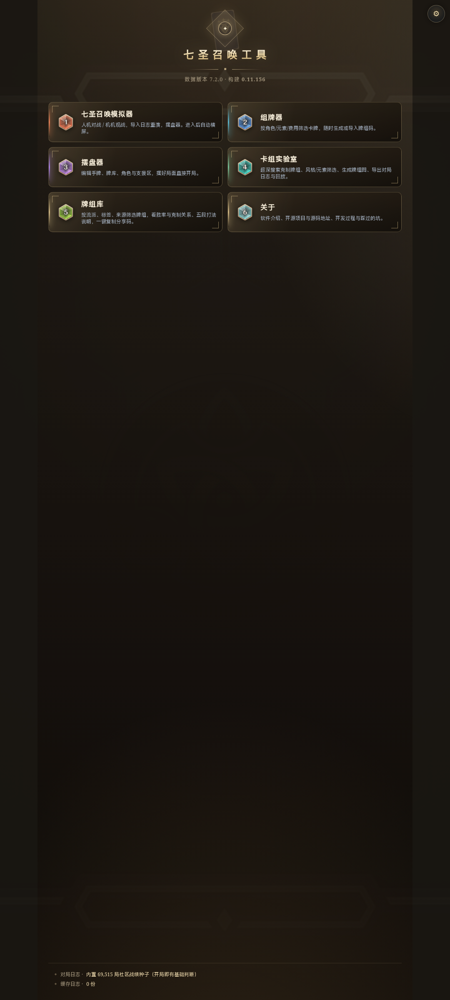
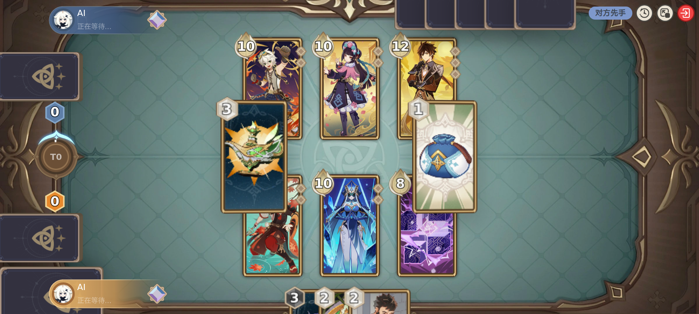
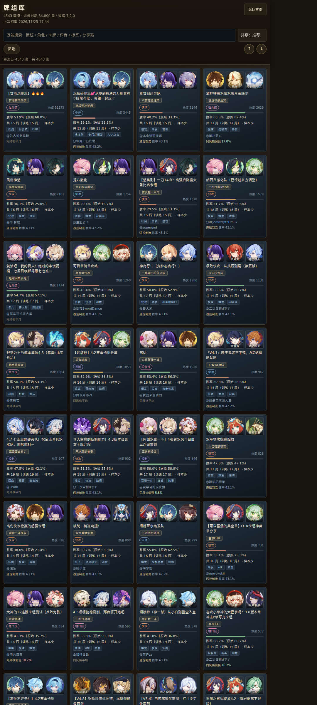
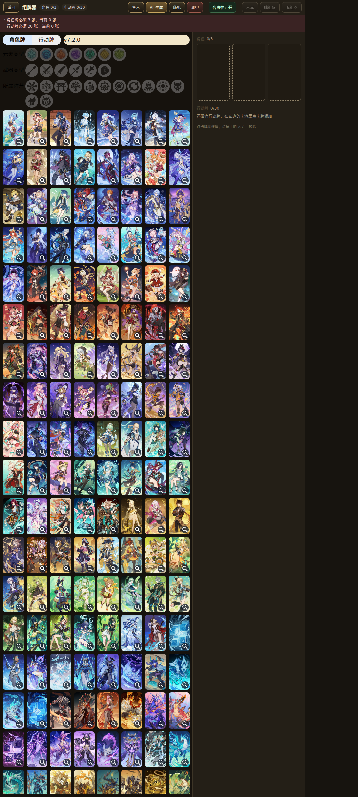
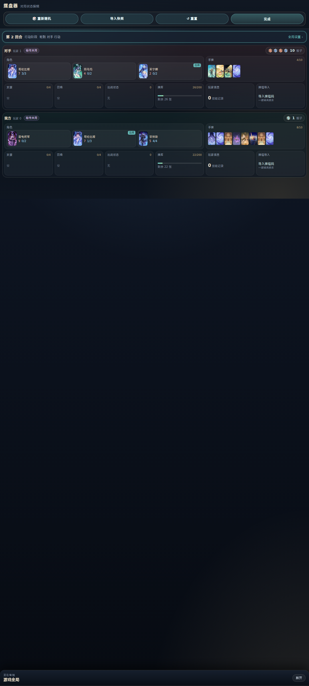
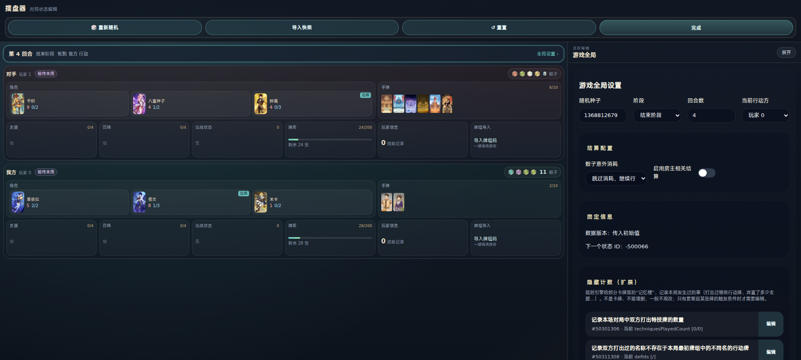
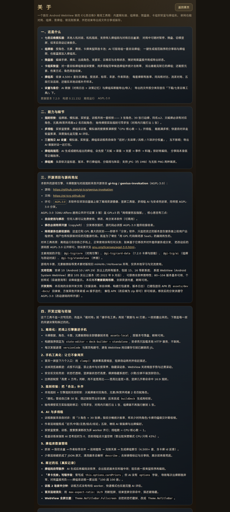

# 新手使用指南

按图的顺序走一遍，5 分钟上手。

---

## 1. 首页

六个入口，一屏点完。顶部是版本号，右上角齿轮进设置。

- **设置**：主体横竖屏、对局布局、AI 数据导入；
- 工具页可以竖屏看，进对局会自动转横屏。

## 2. 打一局

1. 首页点「七圣召唤模拟器」；
2. 顶部选对局模式：
   - **人机对战**：你和 AI 打；
   - **机机观战**：两个 AI 打，适合看套路；
3. 选好双方牌组（或点「随机」）；
4. 点「开始对局」。

- 中间是双方角色区，下面是手牌和骰子；
- 点角色/技能/手牌出行动，右上角是回合与阶段；
- 结束后可以「查看日志」逐帧回放。

## 3. 牌组库

- 顶部筛选：流派、元素、来源、作者、卡牌；
- 每张卡片显示：角色、胜率、对局数、打法标签；
- 点进去看详情：牌组码、五段打法、同风格对比；
- 收藏、复制牌组码、一键生成牌组图。

## 4. 组牌器

1. 先选 3 个角色；
2. 再挑 30 张行动牌（可按费用/元素/类型筛选）；
3. 右上角有合法性检查：不合规会写清原因；
4. 合规后可「生成牌组码」「导出牌组图」「加入牌组库」。

## 5. 卡组实验室

1. 粘贴对手的牌组码（或从牌组库选一套）；
2. 设置「每副候选对局数」（2~30，默认 6）；
3. 点「开始深度搜索」，等进度条跑完；
4. 结果按克制率排序，点进去看详情，可一键生成牌组图。

## 6. 摆盘器

1. 拖拽摆放双方手牌、牌库、骰子、角色位置；
2. 摆好点「完成摆盘 → 开局」；
3. 打完回到摆盘器可以继续改；
4. 也可以导出局面快照分享给别人。

## 7. 导入 AI 经验

1. 电脑上跑训练器，导出 `gitcg-trained-ai-*.json`；
2. 传到手机；
3. 设置 → 导入 AI 数据 → 选文件；
4. 按对局数合并，不会覆盖手机已有经验。

## 8. 关于页

版本号、更新日志、支持范围、许可说明都在这里。

---

## 遇到问题

- 先看 [KNOWN-ISSUES.zh.md](./KNOWN-ISSUES.zh.md)；
- 还不行就提 Issue（带版本号、屏幕比例、复现步骤）。
